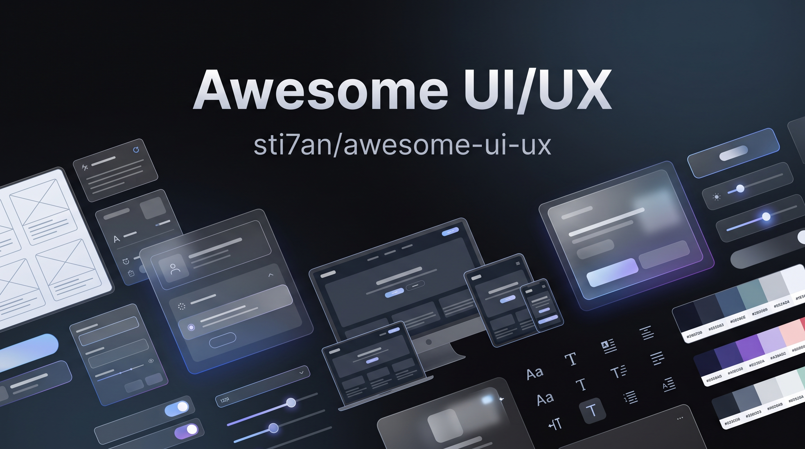

  

  # Awesome UI/UX 

  > Designing the interfaces and experiences of websites and apps.

Welcome! Whether you're sketching your first wireframe, shipping a design system, or running your hundredth usability test, you'll find something useful here. Every entry is picked by hand, kept short, and checked for links that still work. Spot something missing or outdated? [Contributions](#contributing) are very welcome.

## Contents

- [Foundations and Principles](#foundations-and-principles)
- [UX Research](#ux-research)
- [Analytics and Experimentation](#analytics-and-experimentation)
- [Information Architecture and Flows](#information-architecture-and-flows)
- [UX Writing and Content Design](#ux-writing-and-content-design)
- [Interaction Design](#interaction-design)
- [Typography](#typography)
- [Color](#color)
- [Icons](#icons)
- [Illustrations and Imagery](#illustrations-and-imagery)
- [Mockups and Placeholders](#mockups-and-placeholders)
- [Layout and Responsive Design](#layout-and-responsive-design)
- [Motion and Animation](#motion-and-animation)
- [Accessibility](#accessibility)
- [Inclusive, Ethical, and Sustainable Design](#inclusive-ethical-and-sustainable-design)
- [Internationalization and RTL](#internationalization-and-rtl)
- [Design Systems](#design-systems)
- [Platform Guidelines](#platform-guidelines)
- [Design Tools](#design-tools)
- [Wireframing and Prototyping](#wireframing-and-prototyping)
- [AI Design Tools](#ai-design-tools)
- [Handoff and Design to Code](#handoff-and-design-to-code)
- [UI Component Libraries](#ui-component-libraries)
- [CSS and Front-End Tooling](#css-and-front-end-tooling)
- [Data Visualization and Dashboards](#data-visualization-and-dashboards)
- [Inspiration and Pattern Galleries](#inspiration-and-pattern-galleries)
- [Case Studies and Company Design Blogs](#case-studies-and-company-design-blogs)
- [Books](#books)
- [Courses and Learning](#courses-and-learning)
- [Newsletters and Blogs](#newsletters-and-blogs)
- [Podcasts](#podcasts)
- [YouTube Channels](#youtube-channels)
- [Communities](#communities)
- [Conferences and Events](#conferences-and-events)
- [Jobs and Portfolios](#jobs-and-portfolios)
- [Checklists and Cheat Sheets](#checklists-and-cheat-sheets)

## Foundations and Principles

- [Laws of UX](https://lawsofux.com/) - Collection of psychology-based principles that shape how people use interfaces.
- [10 Usability Heuristics](https://www.nngroup.com/articles/ten-usability-heuristics/) - Jakob Nielsen's general rules of thumb for interaction design.
- [Nielsen Norman Group Articles](https://www.nngroup.com/articles/) - Research-backed articles on usability and user behavior.
- [Principles.design](https://principles.design/) - Directory of design principles published by companies and teams.
- [Interaction Design Foundation Encyclopedia](https://www.interaction-design.org/literature) - Free reference covering UX and HCI topics.
- [Growth.design Case Studies](https://growth.design/case-studies) - Illustrated breakdowns of the psychology behind well-known products.
- [Good Design by Vitsoe](https://www.vitsoe.com/gb/about/good-design) - Dieter Rams' ten principles of good design.
- [GOV.UK Service Manual](https://www.gov.uk/service-manual) - Practical guidance for building user-centered digital services.
- [UX Design Institute Articles](https://www.uxdesigninstitute.com/blog/) - Introductory and intermediate articles on UX practice.
- [Gestalt Principles](https://www.interaction-design.org/literature/topics/gestalt-principles) - Overview of how people perceive grouping and structure in visual design.

## UX Research

- [NN/g: When to Use Which UX Research Method](https://www.nngroup.com/articles/which-ux-research-methods/) - Guide to choosing research methods by project stage.
- [Baymard Institute](https://baymard.com/) - Large-scale usability research focused on e-commerce.
- [Service Design Tools](https://servicedesigntools.org/) - Library of methods for service design and research.
- [Dovetail](https://dovetail.com/) - Research repository for analyzing and sharing qualitative insights.
- [Condens](https://condens.io/) - Research repository with transcription and tagging.
- [Maze](https://maze.co/) - Unmoderated usability and prototype testing.
- [Lyssna](https://www.lyssna.com/) - Preference tests, five-second tests, and surveys.
- [Optimal Workshop](https://www.optimalworkshop.com/) - Card sorting, tree testing, and information architecture research.
- [UserTesting](https://www.usertesting.com/) - Moderated and unmoderated testing with a participant panel.
- [Lookback](https://lookback.com/) - Live moderated research sessions with recording.
- [User Interviews](https://www.userinterviews.com/) - Participant recruitment marketplace for research studies.
- [UXtweak](https://www.uxtweak.com/) - All-in-one research suite for usability studies.
- [NN/g: Measuring Perceived Usability](https://www.nngroup.com/articles/measuring-perceived-usability/) - Comparison of SUS, NASA-TLX, and the Single Ease Question.

## Analytics and Experimentation

- [Microsoft Clarity](https://clarity.microsoft.com/) - Free session recordings and heatmaps.
- [Hotjar](https://www.hotjar.com/) - Heatmaps, recordings, and on-page feedback.
- [PostHog](https://posthog.com/) - Open-source product analytics with session replay and feature flags.
- [Plausible](https://plausible.io/) - Lightweight, privacy-friendly web analytics.
- [GrowthBook](https://www.growthbook.io/) - Open-source feature flagging and A/B testing.
- [Core Web Vitals](https://web.dev/articles/vitals) - Google's user-centered performance metrics.
- [PageSpeed Insights](https://pagespeed.web.dev/) - Lab and field performance reports for any URL.

## Information Architecture and Flows

- [NN/g: Information Architecture Study Guide](https://www.nngroup.com/articles/ia-study-guide/) - Curated reading list on navigation, labeling, and structure.
- [Whimsical](https://whimsical.com/) - Flowcharts, wireframes, and mind maps in one tool.
- [Miro](https://miro.com/) - Online whiteboard for workshops and journey mapping.
- [FigJam](https://www.figma.com/figjam/) - Collaborative whiteboard from Figma.
- [Excalidraw](https://excalidraw.com/) - Virtual whiteboard with a hand-drawn look.
- [tldraw](https://tldraw.com/) - Infinite canvas for quick diagrams and sketches.
- [Mermaid](https://mermaid.js.org/) - Text-based diagrams rendered from Markdown-like syntax.
- [draw.io](https://www.drawio.com/) - Free diagram editor for flows and architecture.
- [Relume](https://www.relume.io/) - Sitemap and wireframe generator for websites.

## UX Writing and Content Design

- [Material Design: Content Design](https://m3.material.io/foundations/content-design/overview) - Google's guidance on writing for interfaces.
- [Apple HIG: Writing](https://developer.apple.com/design/human-interface-guidelines/writing) - Apple's principles for clear interface text.
- [Microsoft Writing Style Guide](https://learn.microsoft.com/en-us/style-guide/welcome/) - Tone and terminology guidance for technical and product content.
- [Atlassian Content Guidelines](https://atlassian.design/foundations/content) - Voice and tone guidance with practical examples.
- [Mailchimp Content Style Guide](https://styleguide.mailchimp.com/) - Public style guide covering voice, grammar, and word choice.
- [GOV.UK Content Design](https://www.gov.uk/guidance/content-design) - Government guidance on planning, writing, and publishing content.
- [Plain Language Guidelines](https://www.plainlanguage.gov/) - U.S. government guidance on writing for clarity.
- [UX Writing Hub](https://uxwritinghub.com/) - Articles, courses, and resources for UX writers.
- [Content Design London](https://contentdesign.london/) - Training and resources for content designers.
- [Hemingway Editor](https://hemingwayapp.com/) - Editor that highlights dense or hard-to-read sentences.

## Interaction Design

- [Collect UI](https://collectui.com/) - Daily UI challenges grouped by component type.
- [Component Gallery](https://component.gallery/) - Cross-system reference of how common UI components are named and built.
- [Page Flows](https://pageflows.com/) - Recorded user flows from real products.
- [Mobbin](https://mobbin.com/) - Searchable library of mobile and web app screens and flows.
- [Dashboard Design Patterns](https://dashboarddesignpatterns.github.io/) - Research-based patterns for dashboard layouts.
- [Luke Wroblewski: Web Form Design](https://www.lukew.com/resources/web_form_design.asp) - Research and guidance on form usability.
- [How Do Users Really Hold Mobile Devices?](https://www.uxmatters.com/mt/archives/2013/02/how-do-users-really-hold-mobile-devices.php) - Classic study on thumb zones and touch interaction.

## Typography

- [Google Fonts](https://fonts.google.com/) - Open-source font library for the web.
- [Google Fonts Knowledge](https://fonts.google.com/knowledge) - Free guides on type fundamentals and font selection.
- [Fontsource](https://fontsource.org/) - Self-hostable open-source fonts packaged for npm.
- [Bunny Fonts](https://fonts.bunny.net/) - Privacy-friendly drop-in alternative to Google Fonts.
- [Fontshare](https://www.fontshare.com/) - Free quality fonts from the Indian Type Foundry.
- [Font Squirrel](https://www.fontsquirrel.com/) - Hand-picked free fonts licensed for commercial use.
- [Adobe Fonts](https://fonts.adobe.com/) - Font library included with Creative Cloud subscriptions.
- [Inter](https://rsms.me/inter/) - Typeface designed for computer screens.
- [Typewolf](https://www.typewolf.com/) - Font pairings and typography trends.
- [Fonts In Use](https://fontsinuse.com/) - Archive of typography in real-world design.
- [FontPair](https://www.fontpair.co/) - Curated Google Fonts pairings.
- [Type Scale](https://typescale.com/) - Visual calculator for modular font size ratios.
- [Utopia](https://utopia.fyi/) - Fluid type and spacing scale generator.
- [Capsize](https://seek-oss.github.io/capsize/) - Tool for trimming text box whitespace to match the baseline and cap height.
- [Modern Font Stacks](https://modernfontstacks.com/) - System font stacks that need no downloads.
- [Variable Fonts](https://v-fonts.com/) - Catalog and tester for fonts with adjustable axes.
- [Wakamai Fondue](https://wakamaifondue.com/) - Inspector that shows what a font file can do.
- [Practical Typography](https://practicaltypography.com/) - Free online book on typography for everyday documents.

## Color

- [Coolors](https://coolors.co/) - Palette generator with export and contrast tools.
- [Adobe Color](https://color.adobe.com/) - Color wheel with harmony rules and accessibility checks.
- [Realtime Colors](https://www.realtimecolors.com/) - Preview palettes and fonts on a live website layout.
- [Color Hunt](https://colorhunt.co/) - Community-curated palettes.
- [Huemint](https://huemint.com/) - Machine-learning palette generator for brands and interfaces.
- [OKLCH Color Picker](https://oklch.com/) - Picker and converter for perceptually uniform colors.
- [Leonardo](https://leonardocolor.io/) - Contrast-based color scale generator.
- [Radix Colors](https://www.radix-ui.com/colors) - Accessible color scales designed for UI.
- [Material Theme Builder](https://material-foundation.github.io/material-theme-builder/) - Generates Material 3 color schemes from a seed color.
- [WebAIM Contrast Checker](https://webaim.org/resources/contrastchecker/) - Check text and background contrast against WCAG.
- [Who Can Use](https://www.whocanuse.com/) - Shows how color combinations affect people with different vision conditions.
- [Color Review](https://color.review/) - Contrast checker with real-time feedback.
- [Color Oracle](https://colororacle.org/) - Desktop color blindness simulator.
- [ColorBrewer](https://colorbrewer2.org/) - Color schemes designed for maps and charts.
- [Color in UI Design: A Practical Framework](https://www.learnui.design/blog/color-in-ui-design-a-practical-framework.html) - Step-by-step method for building UI palettes.

## Icons

- [Lucide](https://lucide.dev/) - Consistent, open-source icon set.
- [Phosphor Icons](https://phosphoricons.com/) - Flexible icon family with multiple weights.
- [Heroicons](https://heroicons.com/) - Hand-crafted SVG icons from the makers of Tailwind CSS.
- [Tabler Icons](https://tabler.io/icons) - Open-source SVG icons with a consistent stroke.
- [Material Symbols](https://fonts.google.com/icons) - Google's variable icon font with adjustable weight and fill.
- [SF Symbols](https://developer.apple.com/sf-symbols/) - Apple's icon library designed to match San Francisco type.
- [Fluent UI System Icons](https://github.com/microsoft/fluentui-system-icons) - Microsoft's icon library for Fluent apps.
- [Bootstrap Icons](https://icons.getbootstrap.com/) - Open-source icon library from the Bootstrap team.
- [Font Awesome](https://fontawesome.com/) - Popular icon toolkit with free and paid tiers.
- [Remix Icon](https://remixicon.com/) - Neutral-style open-source icon system.
- [Radix Icons](https://www.radix-ui.com/icons) - Crisp 15 by 15 pixel icon set.
- [Iconoir](https://iconoir.com/) - Large open-source icon library with a clean line style.
- [Iconify](https://iconify.design/) - Unified framework that serves many open-source icon sets.
- [Icônes](https://icones.js.org/) - Fast search across Iconify collections.
- [Simple Icons](https://simpleicons.org/) - SVG icons for popular brands.
- [The Noun Project](https://thenounproject.com/) - Marketplace of icons from a global community.
- [SVG Repo](https://www.svgrepo.com/) - Searchable collection of free SVG vectors.
- [SVGOMG](https://jakearchibald.github.io/svgomg/) - Browser interface for optimizing SVG files.

## Illustrations and Imagery

- [unDraw](https://undraw.co/) - Open-source illustrations with customizable colors.
- [Open Peeps](https://www.openpeeps.com/) - Hand-drawn illustration library of mix-and-match people.
- [Storyset](https://storyset.com/) - Customizable, animated illustrations.
- [Humaaans](https://www.humaaans.com/) - Mix-and-match people illustrations.
- [DrawKit](https://www.drawkit.com/) - Free and premium vector illustration packs.
- [Blush](https://blush.design/) - Illustrations from artists around the world, with a built-in editor.
- [Haikei](https://haikei.app/) - Generator for SVG waves, blobs, and background shapes.
- [Unsplash](https://unsplash.com/) - Free high-resolution photography.
- [Pexels](https://www.pexels.com/) - Free stock photos and videos.
- [Pixabay](https://pixabay.com/) - Free images, videos, and music.
- [Burst](https://www.shopify.com/stock-photos) - Free stock photos from Shopify.
- [Openverse](https://openverse.org/) - Search engine for openly licensed media.
- [Rawpixel Public Domain](https://www.rawpixel.com/public-domain) - Public domain images and illustrations.
- [Smithsonian Open Access](https://www.si.edu/openaccess) - Millions of collection images released under CC0.
- [Squoosh](https://squoosh.app/) - Browser-based image compression and format conversion.
- [TinyPNG](https://tinypng.com/) - Smart lossy compression for PNG, JPEG, and WebP.

## Mockups and Placeholders

- [Shots](https://shots.so/) - Browser, device, and social mockups from screenshots.
- [Previewed](https://previewed.app/) - Mockups for apps, websites, and branding.
- [SmartMockups](https://smartmockups.com/) - Online mockup generator now part of Canva.
- [Rotato](https://rotato.app/) - Animated 3D device mockups for Mac.
- [Lorem Picsum](https://picsum.photos/) - Placeholder photos by URL.
- [Placehold.co](https://placehold.co/) - Simple placeholder image service.

## Layout and Responsive Design

- [Every Layout](https://every-layout.dev/) - Algorithmic layout primitives for resilient CSS.
- [Learn Responsive Design](https://web.dev/learn/design) - Free course on building responsive layouts.
- [Grid by Example](https://gridbyexample.com/) - Patterns and tutorials for CSS Grid.
- [CSS-Tricks: Complete Guide to Grid](https://css-tricks.com/snippets/css/complete-guide-grid/) - Visual reference for every CSS Grid property.
- [CSS-Tricks: Complete Guide to Flexbox](https://css-tricks.com/snippets/css/a-guide-to-flexbox/) - Visual reference for every Flexbox property.
- [Interactive Guide to Flexbox](https://www.joshwcomeau.com/css/interactive-guide-to-flexbox/) - Hands-on explanation of how Flexbox works.
- [Interactive Guide to CSS Grid](https://www.joshwcomeau.com/css/interactive-guide-to-grid/) - Hands-on explanation of how CSS Grid works.
- [Flexbox Froggy](https://flexboxfroggy.com/) - Game for learning Flexbox.
- [CSS Grid Garden](https://cssgridgarden.com/) - Game for learning CSS Grid.
- [Material Design: Understanding Layout](https://m3.material.io/foundations/layout/understanding-layout/overview) - Guidance on grids, spacing, and responsive structure.
- [Container Queries on MDN](https://developer.mozilla.org/en-US/docs/Web/CSS/CSS_containment/Container_queries) - Reference for component-level responsive design.
- [The 8-Point Grid](https://spec.fm/specifics/8-pt-grid) - Rationale for spacing UI on an 8-pixel rhythm.
- [Polypane](https://polypane.app/) - Browser built for responsive development and testing.
- [Responsively App](https://responsively.app/) - Open-source browser that shows many viewports at once.

## Motion and Animation

- [Motion](https://motion.dev/) - Animation library for React, JavaScript, and Vue.
- [GSAP](https://gsap.com/) - Professional-grade JavaScript animation platform.
- [LottieFiles](https://lottiefiles.com/) - Platform and library for Lottie animations.
- [Rive](https://rive.app/) - Real-time interactive animation tool and runtime.
- [Spline](https://spline.design/) - Collaborative 3D design in the browser.
- [Jitter](https://jitter.video/) - Browser-based motion design for interface animation.
- [Easings.net](https://easings.net/) - Cheat sheet of easing functions.
- [cubic-bezier.com](https://cubic-bezier.com/) - Visual editor for CSS timing curves.
- [Animista](https://animista.net/) - Library of ready-made CSS animations.
- [Animate.css](https://animate.style/) - Cross-browser CSS animation library.
- [AutoAnimate](https://auto-animate.formkit.com/) - Zero-config animations for adding and removing elements.
- [Interactive Guide to CSS Transitions](https://www.joshwcomeau.com/animation/css-transitions/) - Deep dive into transitions with live demos.
- [Material Design: Motion](https://m3.material.io/styles/motion/overview) - Principles and tokens for meaningful motion.
- [Apple HIG: Motion](https://developer.apple.com/design/human-interface-guidelines/motion) - Guidance on purposeful motion in Apple apps.
- [Respecting prefers-reduced-motion](https://web.dev/articles/prefers-reduced-motion) - How to adapt animation for people who need less movement.

## Accessibility

- [WCAG 2.2](https://www.w3.org/TR/WCAG22/) - Current W3C Recommendation for web accessibility.
- [WCAG 3.0 Working Draft](https://www.w3.org/TR/wcag-3.0/) - Draft of the next major accessibility guidelines.
- [WAI-ARIA Authoring Practices Guide](https://www.w3.org/WAI/ARIA/apg/) - Patterns for building accessible widgets.
- [WebAIM](https://webaim.org/) - Articles, tools, and training from Utah State University.
- [The WebAIM Million](https://webaim.org/projects/million/) - Annual accessibility analysis of the top million home pages.
- [The A11Y Project](https://www.a11yproject.com/) - Community-driven accessibility resources and checklist.
- [Inclusive Components](https://inclusive-components.design/) - Blog on building accessible interface components.
- [MDN Accessibility](https://developer.mozilla.org/en-US/docs/Web/Accessibility) - Developer documentation on accessible web practices.
- [Learn Accessibility](https://web.dev/learn/accessibility) - Free course from Google on accessible web development.
- [Practical Accessibility](https://practical-accessibility.today/) - Course on accessibility for designers and developers.
- [Accessibility Developer Guide](https://www.accessibility-developer-guide.com/) - Practical guide to building accessible websites.
- [Making Content Usable for People with Cognitive Disabilities](https://www.w3.org/TR/coga-usable/) - W3C guidance on cognitive accessibility.
- [Dos and Don'ts on Designing for Accessibility](https://accessibility.blog.gov.uk/2016/09/02/dos-and-donts-on-designing-for-accessibility/) - Posters from GOV.UK covering common user needs.
- [Adrian Roselli](https://adrianroselli.com/) - In-depth articles on accessible HTML, ARIA, and CSS.
- [axe DevTools](https://www.deque.com/axe/) - Automated accessibility testing for browsers and CI.
- [axe-core](https://github.com/dequelabs/axe-core) - Open-source accessibility testing engine.
- [WAVE](https://wave.webaim.org/) - Visual accessibility evaluation tool.
- [Lighthouse](https://developer.chrome.com/docs/lighthouse/overview) - Automated audits for accessibility, performance, and best practices.
- [Accessibility Insights](https://accessibilityinsights.io/) - Microsoft's tools for finding and fixing accessibility issues.
- [Pa11y](https://pa11y.org/) - Command-line and CI accessibility testing.
- [Sa11y](https://sa11y.netlify.app/) - Accessibility checker for content authors.
- [ARC Toolkit](https://www.tpgi.com/arc-platform/arc-toolkit/) - Browser extension for testing against WCAG.
- [Stark](https://www.getstark.co/) - Accessibility checks inside Figma, Sketch, and browsers.
- [NVDA](https://www.nvaccess.org/) - Free open-source screen reader for Windows.

## Inclusive, Ethical, and Sustainable Design

- [Deceptive Patterns](https://www.deceptive.design/) - Library and reporting hub for manipulative design tactics.
- [Microsoft Inclusive Design](https://inclusive.microsoft.design/) - Toolkits and principles for designing with diverse people.
- [Inclusive Design Principles](https://inclusivedesignprinciples.info/) - Seven principles for inclusive web design.
- [Inclusive Design Toolkit](https://www.inclusivedesigntoolkit.com/) - University of Cambridge resource for inclusive product design.
- [Design Justice Network](https://designjustice.org/) - Community advancing design practices that center marginalized people.
- [Center for Humane Technology](https://www.humanetech.com/) - Research and tools for technology that supports wellbeing.
- [Humane by Design](https://humanebydesign.com/) - Guidance on designing digital products with respect for users.
- [Sustainable Web Design](https://sustainablewebdesign.org/) - Strategies for reducing the environmental impact of websites.
- [Website Carbon Calculator](https://www.websitecarbon.com/) - Estimates the carbon footprint of a web page.
- [The Green Web Foundation](https://www.thegreenwebfoundation.org/) - Tools for finding green hosting and measuring digital emissions.

## Internationalization and RTL

- [RTL Styling 101](https://rtlstyling.com/) - Practical guide to building right-to-left interfaces.
- [W3C Internationalization](https://www.w3.org/International/) - Resources for making web content work across languages and regions.
- [Material Design: Bidirectionality](https://m3.material.io/foundations/layout/understanding-layout/bidirectionality-rtl) - Guidance on mirroring layouts and icons.
- [Unicode CLDR](https://cldr.unicode.org/) - Standard locale data for dates, numbers, and names.

## Design Systems

- [Atomic Design](https://atomicdesign.bradfrost.com/) - Brad Frost's methodology for building interface systems, free to read online.
- [Design Systems Repo](https://designsystemsrepo.com/) - Directory of public design systems and style guides.
- [Storybook](https://storybook.js.org/) - Workshop for building and documenting UI components in isolation.
- [zeroheight](https://zeroheight.com/) - Documentation platform for design systems.
- [Supernova](https://www.supernova.io/) - Design system management and token automation.
- [Chromatic](https://www.chromatic.com/) - Visual testing and review for Storybook.
- [Design Tokens Community Group](https://www.designtokens.org/) - Home of the stable Design Tokens specification.
- [Style Dictionary](https://styledictionary.com/) - Build system that transforms design tokens for any platform.
- [Tokens Studio](https://tokens.studio/) - Token management for Figma and Penpot.
- [EightShapes on Medium](https://medium.com/eightshapes-llc) - Articles on design system practice from Nathan Curtis and team.
- [Material Design 3](https://m3.material.io/) - Google's open-source design system.
- [Fluent 2](https://fluent2.microsoft.design/) - Microsoft's cross-platform design system.
- [Carbon Design System](https://carbondesignsystem.com/) - IBM's open-source design system.
- [Atlassian Design System](https://atlassian.design/) - Foundations, components, and patterns for Atlassian products.
- [Polaris](https://polaris.shopify.com/) - Shopify's design system.
- [Primer](https://primer.style/) - GitHub's design system.
- [Spectrum](https://spectrum.adobe.com/) - Adobe's design system.
- [Lightning Design System](https://www.lightningdesignsystem.com/) - Salesforce's design system.
- [Ant Design](https://ant.design/) - Enterprise-class design language and React component library.
- [Gestalt](https://gestalt.pinterest.systems/) - Pinterest's design system.
- [Orbit](https://orbit.kiwi/) - Kiwi.com's design system for travel products.
- [Wise Design](https://wise.design/) - Wise's design system for financial products.
- [GOV.UK Design System](https://design-system.service.gov.uk/) - Styles, components, and patterns for UK government services.
- [U.S. Web Design System](https://designsystem.digital.gov/) - Design system for U.S. federal websites.

## Platform Guidelines

- [Apple Human Interface Guidelines](https://developer.apple.com/design/human-interface-guidelines/) - Design guidance for iOS, iPadOS, macOS, watchOS, tvOS, and visionOS.
- [Liquid Glass](https://developer.apple.com/documentation/technologyoverviews/liquid-glass) - Apple's documentation for its dynamic translucent material.
- [Android Design](https://developer.android.com/design) - Google's guidance for building Android apps.
- [Windows App Design](https://learn.microsoft.com/en-us/windows/apps/design/) - Microsoft's guidance for Windows apps.
- [GNOME Human Interface Guidelines](https://developer.gnome.org/hig/) - Design guidance for GNOME applications.
- [KDE Human Interface Guidelines](https://develop.kde.org/hig/) - Design guidance for KDE applications.
- [Progressive Web Apps](https://web.dev/learn/pwa) - Course on building installable web apps.

## Design Tools

- [Figma](https://www.figma.com/) - Collaborative interface design tool in the browser.
- [Figma Community](https://www.figma.com/community) - Free templates, plugins, and UI kits shared by designers.
- [Penpot](https://penpot.app/) - Open-source design and prototyping platform built on web standards.
- [Penpot Libraries and Templates](https://penpot.app/libraries-templates) - Free resources for Penpot users.
- [Sketch](https://www.sketch.com/) - Native macOS vector design tool.
- [Framer](https://www.framer.com/) - Design tool that publishes interactive websites.
- [Lunacy](https://icons8.com/lunacy) - Free design app that opens Sketch files.
- [Canva](https://www.canva.com/) - Online design platform for graphics and presentations.
- [Webflow](https://webflow.com/) - Visual builder for production websites.
- [Inkscape](https://inkscape.org/) - Free and open-source vector graphics editor.
- [Krita](https://krita.org/) - Free and open-source digital painting program.
- [UX Tools](https://uxtools.co/) - Annual surveys and reviews of design tools.
- [Figma Learn](https://help.figma.com/) - Official documentation and tutorials for Figma.

## Wireframing and Prototyping

- [Balsamiq](https://balsamiq.com/) - Low-fidelity wireframing with a sketched look.
- [Wireframe.cc](https://wireframe.cc/) - Minimal wireframing tool for quick layouts.
- [Axure RP](https://www.axure.com/) - Prototyping with conditional logic and dynamic content.
- [UXPin](https://www.uxpin.com/) - Code-based prototyping with real components.
- [ProtoPie](https://www.protopie.io/) - Prototyping for sensor-rich and multi-device interactions.
- [Origami Studio](https://origami.design/) - Facebook's tool for building interactive prototypes.

## AI Design Tools

- [Figma Make](https://www.figma.com/make/) - Prompt-based tool that builds interactive prototypes from your designs.
- [Google Stitch](https://stitch.withgoogle.com/) - Google Labs tool that generates interface designs from prompts.
- [v0](https://v0.app/) - Vercel's assistant for generating React and Tailwind interfaces.
- [Uizard](https://uizard.io/) - Converts sketches and prompts into editable mockups.
- [Magic Patterns](https://www.magicpatterns.com/) - Prompt-based tool for UI prototypes and components.
- [UX Pilot](https://uxpilot.ai/) - Generates wireframes and screens with AI design reviews.
- [Adobe Firefly](https://www.adobe.com/products/firefly.html) - Generative models for images, vectors, and design assets.
- [Khroma](https://www.khroma.co/) - Learns your color preferences to generate palettes.

## Handoff and Design to Code

- [Figma Dev Mode](https://www.figma.com/dev-mode/) - Inspect designs and copy code in Figma.
- [Zeplin](https://zeplin.io/) - Handoff platform that connects designers and developers.
- [Anima](https://www.animaapp.com/) - Converts Figma designs to React, HTML, and Vue code.
- [Locofy](https://www.locofy.ai/) - Turns Figma and prompts into front-end code.
- [Builder.io](https://www.builder.io/) - Visual development platform with design-to-code tooling.

## UI Component Libraries

- [shadcn/ui](https://ui.shadcn.com/) - Copy-and-paste components built with Radix UI and Tailwind CSS.
- [Radix Primitives](https://www.radix-ui.com/primitives) - Unstyled, accessible React components.
- [React Aria](https://react-spectrum.adobe.com/react-aria/) - Adobe's hooks and components for accessible interfaces.
- [Headless UI](https://headlessui.com/) - Unstyled accessible components for React and Vue.
- [Ark UI](https://ark-ui.com/) - Headless component library for multiple frameworks.
- [Base UI](https://base-ui.com/) - Unstyled React components from the MUI team.
- [Bits UI](https://bits-ui.com/) - Headless components for Svelte.
- [Material UI](https://mui.com/) - React components implementing Material Design.
- [Chakra UI](https://chakra-ui.com/) - Accessible React component system.
- [Mantine](https://mantine.dev/) - React component library with hooks and extensions.
- [HeroUI](https://www.heroui.com/) - React component library built on Tailwind CSS.
- [daisyUI](https://daisyui.com/) - Component classes for Tailwind CSS.
- [Flowbite](https://flowbite.com/) - Components and blocks built with Tailwind CSS.
- [Aceternity UI](https://ui.aceternity.com/) - Animated components for React and Tailwind CSS.
- [Magic UI](https://magicui.design/) - Animated React components for landing pages.
- [PrimeReact](https://primereact.org/) - Rich UI component suite for React.
- [Vuetify](https://vuetifyjs.com/) - Material Design component framework for Vue.
- [Element Plus](https://element-plus.org/) - Desktop-oriented components for Vue 3.
- [Angular Material](https://material.angular.io/) - Material Design components for Angular.
- [Skeleton](https://www.skeleton.dev/) - Adaptive design system for Svelte and Tailwind CSS.
- [Web Awesome](https://webawesome.com/) - Framework-agnostic web component library.
- [UI Design Daily](https://uidesigndaily.com/) - Free UI design resources and components updated daily.

## CSS and Front-End Tooling

- [Tailwind CSS](https://tailwindcss.com/) - Utility-first CSS framework.
- [Bootstrap](https://getbootstrap.com/) - Widely used CSS framework and component library.
- [Bulma](https://bulma.io/) - Modern CSS framework based on Flexbox.
- [UnoCSS](https://unocss.dev/) - Instant on-demand atomic CSS engine.
- [Open Props](https://open-props.style/) - CSS custom properties for design tokens.
- [Pico CSS](https://picocss.com/) - Minimal CSS framework for semantic HTML.
- [Modern CSS Solutions](https://moderncss.dev/) - Tutorials on modern CSS techniques.
- [Piccalilli](https://piccalil.li/) - Courses and articles on CSS and front-end design.
- [Ahmad Shadeed](https://ishadeed.com/) - Interactive articles on CSS layout and components.
- [CSS for JavaScript Developers](https://css-for-js.dev/) - Course on how CSS really works.
- [Can I Use](https://caniuse.com/) - Browser support tables for web features.
- [CSS Gradient](https://cssgradient.io/) - Gradient generator with CSS output.
- [Shadow Palette Generator](https://www.joshwcomeau.com/shadow-palette/) - Builds layered shadows that match a surface color.
- [Fancy Border Radius](https://9elements.github.io/fancy-border-radius/) - Generator for organic border radius shapes.
- [Clippy](https://bennettfeely.com/clippy/) - Visual editor for CSS clip-path.
- [Get Waves](https://getwaves.io/) - SVG wave generator for section dividers.

## Data Visualization and Dashboards

- [From Data to Viz](https://www.data-to-viz.com/) - Decision tree for choosing the right chart.
- [Data Viz Project](https://datavizproject.com/) - Catalog of chart types with usage guidance.
- [Datawrapper](https://www.datawrapper.de/) - Tool for creating charts, maps, and tables.
- [Storytelling with Data](https://www.storytellingwithdata.com/) - Blog and training on communicating with data.
- [Information Is Beautiful](https://informationisbeautiful.net/) - Data visualizations and infographics.
- [Nightingale](https://nightingaledvs.com/) - Journal of the Data Visualization Society.
- [Chartability](https://chartability.fizz.studio/) - Framework for auditing data visualization accessibility.
- [D3](https://d3js.org/) - Low-level JavaScript library for custom visualizations.
- [Observable](https://observablehq.com/) - Collaborative notebooks for data exploration.
- [Observable Plot](https://observablehq.com/plot/) - Concise library for exploratory charts.
- [Vega-Lite](https://vega.github.io/vega-lite/) - Grammar of interactive graphics.
- [Apache ECharts](https://echarts.apache.org/) - Feature-rich charting library.
- [Chart.js](https://www.chartjs.org/) - Simple and flexible charts for the web.
- [Recharts](https://recharts.org/) - Composable charting library for React.
- [Tremor](https://www.tremor.so/) - React components for dashboards.
- [Flourish](https://flourish.studio/) - Platform for interactive charts and data stories.

## Inspiration and Pattern Galleries

- [Dribbble](https://dribbble.com/) - Community where designers share work in progress.
- [Behance](https://www.behance.net/) - Portfolio platform for creative professionals.
- [Awwwards](https://www.awwwards.com/) - Awards and showcase for web design excellence.
- [SiteInspire](https://www.siteinspire.com/) - Curated gallery of web design.
- [Land-book](https://land-book.com/) - Gallery of landing pages.
- [Lapa Ninja](https://www.lapa.ninja/) - Landing page examples organized by category.
- [SaaS Landing Page](https://saaslandingpage.com/) - Landing pages from software companies.
- [Landingfolio](https://www.landingfolio.com/) - Landing page and component inspiration.
- [One Page Love](https://onepagelove.com/) - Single-page website gallery.
- [Godly](https://godly.website/) - Curated showcase of astonishing web design.
- [Httpster](https://httpster.net/) - Hand-picked website inspiration.
- [Minimal Gallery](https://minimal.gallery/) - Showcase of minimal web design.
- [Dark Mode Design](https://www.darkmodedesign.com/) - Gallery of dark-themed websites.
- [Framer Gallery](https://www.framer.com/gallery/) - Websites built and published with Framer.
- [Refero](https://refero.design/) - Searchable library of real product screens.
- [Screenlane](https://screenlane.com/) - Mobile and web interface patterns.
- [Muzli](https://muz.li/) - Daily design inspiration and trends.
- [Designspiration](https://www.designspiration.com/) - Visual inspiration board for designers.
- [Brand New](https://www.underconsideration.com/brandnew/) - Reviews of corporate and brand identity work.
- [Really Good Emails](https://reallygoodemails.com/) - Gallery of email design.
- [Checklist Design](https://www.checklist.design/) - Detailed checklists and examples of product flows.
- [Codrops](https://tympanus.net/codrops/) - Tutorials and demos for creative front-end work.
- [CodePen](https://codepen.io/) - Online editor and showcase for front-end code.

## Case Studies and Company Design Blogs

- [Google Design](https://design.google/) - Stories and resources from Google's design teams.
- [Airbnb Design](https://airbnb.design/) - Essays and case studies from a travel marketplace's design teams.
- [Spotify Design](https://spotify.design/) - Articles on design practice at Spotify.
- [Meta Design](https://design.facebook.com/) - Design resources and stories from Meta.
- [Linear Method](https://linear.app/method) - Principles and practices for building product.
- [Apple Design Awards](https://developer.apple.com/design/awards/) - Annual awards recognizing outstanding apps and games.

## Books

- [Don't Make Me Think](https://sensible.com/dont-make-me-think/) - Steve Krug's classic on web usability.
- [The Design of Everyday Things](https://www.hachettebookgroup.com/titles/don-norman/the-design-of-everyday-things/9780465050659/) - Don Norman on human-centered design.
- [About Face](https://www.wiley.com/en-us/About+Face%3A+The+Essentials+of+Interaction+Design%2C+4th+Edition-p-9781118766576) - Alan Cooper's reference on interaction design.
- [Refactoring UI](https://www.refactoringui.com/) - Practical visual design for developers.
- [Laws of UX: Using Psychology to Design Better Products](https://lawsofux.com/book/) - Jon Yablonski's guide to applying psychology to interface design.
- [Designing Interfaces](https://designinginterfaces.com/) - Jenifer Tidwell's catalog of interface patterns.
- [Microinteractions](https://microinteractions.com/) - Dan Saffer on designing small moments in interfaces.
- [Just Enough Research](https://abookapart.com/products/just-enough-research) - Erika Hall on practical user research.
- [Mismatch](https://mitpress.mit.edu/9780262543453/mismatch/) - Kat Holmes on inclusive design.
- [Design Systems](https://www.smashingmagazine.com/design-systems-book/) - Alla Kholmatova on creating shared design languages that scale.
- [Designing for Emotion](https://abookapart.com/products/designing-for-emotion) - Aarron Walter on personality in interfaces.
- [Mobile First](https://abookapart.com/products/mobile-first) - Luke Wroblewski on designing for small screens first.
- [Accessibility for Everyone](https://abookapart.com/products/accessibility-for-everyone) - Laura Kalbag's introduction to accessible design.
- [Resilient Web Design](https://resilientwebdesign.com/) - Jeremy Keith's free book on the web's design principles.
- [Thinking with Type](https://thinkingwithtype.com/) - Ellen Lupton's guide to typography.
- [The Visual Display of Quantitative Information](https://www.edwardtufte.com/book/the-visual-display-of-quantitative-information/) - Edward Tufte's foundational book on graphical excellence.
- [The Microcopy Book](https://www.microcopybook.com/) - Guide to writing interface text.
- [Sprint](https://www.thesprintbook.com/) - Five-day process for solving problems through design and testing.

## Courses and Learning

- [Interaction Design Foundation](https://www.interaction-design.org/) - Online UX courses and certificates.
- [Google UX Design Certificate](https://grow.google/certificates/ux-design/) - Beginner-friendly professional certificate.
- [Human-Computer Interaction Specialization](https://www.coursera.org/specializations/human-computer-interaction) - University of California San Diego courses on HCI.
- [HackDesign](https://hackdesign.org/) - Free design lessons delivered weekly.
- [Learn UI Design](https://www.learnui.design/) - Erik Kennedy's course on visual UI design.
- [Design+Code](https://designcode.io/) - Courses on design and front-end development.
- [web.dev Learn](https://web.dev/learn) - Free courses on modern web development.
- [freeCodeCamp](https://www.freecodecamp.org/) - Free interactive curriculum for web development.
- [NN/g Training](https://www.nngroup.com/training/) - Courses and certification from Nielsen Norman Group.
- [Animations on the Web](https://animations.dev/) - Course by Emil Kowalski on interface animation.

## Newsletters and Blogs

- [UX Collective](https://uxdesign.cc/) - Publication on UX and product design.
- [UX Planet](https://uxplanet.org/) - Articles on UX, UI, and product design.
- [Smashing Magazine](https://www.smashingmagazine.com/) - Articles on web design and front-end development.
- [A List Apart](https://alistapart.com/) - Articles on web standards, design, and content.
- [Sidebar](https://sidebar.io/) - Five top design links every day.
- [UX Design Weekly](https://uxdesignweekly.com/) - Weekly curated UX articles and resources.
- [Web Design Weekly](https://web-design-weekly.com/) - Weekly newsletter for designers and developers.
- [Frontend Focus](https://frontendfoc.us/) - Weekly roundup of front-end news.
- [CSS Weekly](https://css-weekly.com/) - Weekly newsletter on CSS.
- [A11y Weekly](https://a11yweekly.com/) - Weekly newsletter on accessibility.
- [Design Better](https://designbetter.com/) - Books, podcast, and articles on product design.
- [Luke Wroblewski](https://www.lukew.com/) - Writing on digital product design.
- [Brad Frost](https://bradfrost.com/) - Writing on design systems and the web.
- [Josh Comeau](https://www.joshwcomeau.com/) - Interactive tutorials on CSS and React.

## Podcasts

- [Design Details](https://designdetails.fm/) - Conversations about design and designers.
- [Design Matters](https://www.designmattersmedia.com/) - Debbie Millman's interviews with creative people.
- [The UX Podcast](https://uxpodcast.com/) - Long-running show about user experience.
- [Design Better Podcast](https://designbetterpodcast.com/) - Interviews with product design leaders.
- [Design Systems Podcast](https://www.designsystemspodcast.com/) - Conversations about building and scaling design systems.
- [Awkward Silences](https://www.awkwardsilences.com/) - User research podcast.
- [Shop Talk Show](https://shoptalkshow.com/) - Web design and development conversation.
- [99% Invisible](https://99percentinvisible.org/) - Stories about the hidden side of design.

## YouTube Channels

- [Figma on YouTube](https://www.youtube.com/@Figma) - Official tutorials and talks.
- [DesignCourse](https://www.youtube.com/@DesignCourse) - UI, UX, and front-end tutorials.
- [Kevin Powell](https://www.youtube.com/@KevinPowell) - Clear tutorials on CSS.
- [Layout Land](https://www.youtube.com/c/LayoutLand) - Jen Simmons on modern CSS layout.
- [Google Chrome Developers](https://www.youtube.com/@ChromeDevs) - Talks on the modern web platform.
- [AJ&Smart](https://www.youtube.com/@AJSmart) - Design sprint and workshop content.
- [Mizko](https://www.youtube.com/@mizko) - UI design and career advice.
- [Apple Developer](https://www.youtube.com/@AppleDeveloper) - WWDC design sessions and tutorials.

## Communities

- [Designer Hangout](https://designerhangout.co/) - Online community for product designers.
- [ADPList](https://adplist.org/) - Free design mentorship from experienced mentors.
- [IxDA](https://ixda.org/) - Global network for interaction designers.
- [UXPA](https://uxpa.org/) - Professional association for UX practitioners.
- [UX Mastery Community](https://community.uxmastery.com/) - Forum for UX learners and practitioners.
- [Hexagon UX](https://www.hexagonux.com/) - Community supporting women in UX.
- [UX Stack Exchange](https://ux.stackexchange.com/) - Question and answer site for UX.
- [Figma Forum](https://forum.figma.com/) - Official community forum for Figma users.
- [Penpot Community](https://community.penpot.app/) - Forum for Penpot users and contributors.
- [Web A11y Slack](https://web-a11y.slack.com/) - Slack community for accessibility practitioners.
- [r/userexperience](https://www.reddit.com/r/userexperience/) - Subreddit on UX discussion.
- [r/UI_Design](https://www.reddit.com/r/UI_Design/) - Subreddit for interface design.
- [r/web_design](https://www.reddit.com/r/web_design/) - Subreddit for web design.
- [r/accessibility](https://www.reddit.com/r/accessibility/) - Subreddit for accessibility discussion.
- [r/FigmaDesign](https://www.reddit.com/r/FigmaDesign/) - Subreddit for Figma users.

## Conferences and Events

- [Config](https://config.figma.com/) - Figma's annual design conference.
- [Smashing Conference](https://smashingconf.com/) - Events for designers and developers.
- [CSS Day](https://cssday.nl/) - Conference dedicated to CSS.
- [UX Week](https://uxweek.com/) - Annual design conference.
- [Interaction](https://interaction.ixda.org/) - IxDA's annual conference for practitioners.
- [Awwwards Conference](https://conference.awwwards.com/) - Conference on digital creativity and web design.
- [WWDC](https://developer.apple.com/wwdc/) - Apple's developer conference with design sessions.
- [Google I/O](https://io.google/) - Google's developer conference.
- [axe-con](https://www.deque.com/axe-con/) - Free digital accessibility conference.
- [CSUN Assistive Technology Conference](https://www.csun.at/) - Long-running conference on accessibility and assistive technology.
- [Global Accessibility Awareness Day](https://accessibility.day/) - Annual event promoting digital accessibility.
- [World Usability Day](https://www.worldusabilityday.org/) - Annual event promoting usability.

## Jobs and Portfolios

- [Dribbble Jobs](https://dribbble.com/jobs) - Design job board.
- [Awwwards Jobs](https://www.awwwards.com/jobs/) - Job board for web designers and developers.
- [Coroflot](https://www.coroflot.com/) - Portfolio and job board for designers.
- [UX Jobs Board](https://uxjobsboard.com/) - Job listings for UX roles.
- [Cargo](https://cargo.site/) - Site builder for portfolios.
- [Readymag](https://readymag.com/) - Design tool for portfolios and interactive stories.

## Checklists and Cheat Sheets

- [UX Checklist](https://uxchecklist.github.io/) - Checklist covering each stage of UX design.
- [The A11Y Project Checklist](https://www.a11yproject.com/checklist/) - Plain-language checklist based on WCAG.
- [WebAIM WCAG 2 Checklist](https://webaim.org/standards/wcag/checklist) - Practical checklist for WCAG 2 conformance.
- [GOV.UK Service Standard](https://www.gov.uk/service-manual/service-standard) - Fourteen points for building good public services.

## Related Lists

- [Awesome Design Systems](https://github.com/alexpate/awesome-design-systems#readme) - Design systems, style guides, and pattern libraries.
- [Awesome Design Tools](https://github.com/LisaDziuba/Awesome-Design-Tools#readme) - Tools for designers across the workflow.
- [Awesome A11y](https://github.com/brunopulis/awesome-a11y#readme) - Web accessibility resources.
- [Awesome UI Component Library](https://github.com/anubhavsrivastava/awesome-ui-component-library#readme) - UI component libraries across frameworks.
- [Awesome CSS](https://github.com/awesome-css-group/awesome-css#readme) - CSS frameworks, tools, and resources.
- [Awesome UX](https://github.com/brandonhimpfen/awesome-ux#readme) - UX resources, tools, and guides.

## Contributing

Your suggestions make this list better! Please read the [contribution guidelines](contributing.md) before opening a pull request.
